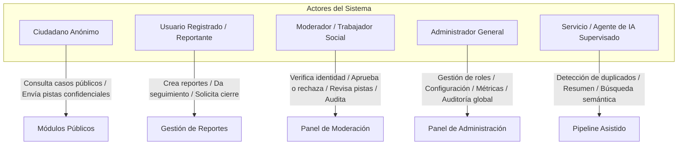
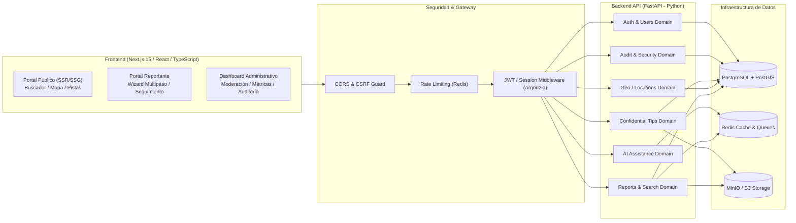
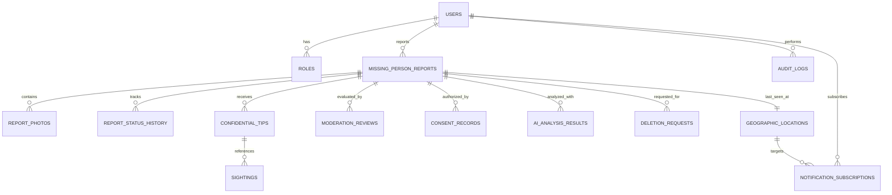

# ENCUÉNTRAME NICARAGUA
## Plataforma Inteligente de Búsqueda y Reunificación Familiar
### Documento Maestro de Ingeniería: Fase 1 (Análisis) y Fase 2 (Planificación)

---

## FASE 1 — ANÁLISIS DE SISTEMA Y MARCO ÉTICO-LEGAL

### 1.1 Contexto y Justificación Social
En Nicaragua, la desaparición o no localización de una persona genera una crisis humanitaria y emocional inmediata en su entorno familiar. Históricamente, las familias recurren a la difusión fragmentada en redes sociales (Facebook, WhatsApp, grupos comunitarios), lo que conlleva severos problemas colaterales:
- **Exposición a estafas y extorsiones:** Familiares publican sus números personales de contacto, convirtiéndose en blancos directos de extorsionistas y estafadores.
- **Desinformación y bulos:** Circulación de información caduca, no contrastada o fotos manipuladas que desvían los recursos y esperanzas de búsqueda.
- **Riesgos de revictimización y violencia de género:** Personas que han huido de contextos de violencia intrafamiliar, violencia machista o trata corren grave peligro si su localización es facilitada inadvertidamente mediante reportes fraudulentos presentados por sus agresores.
- **Falta de agregación geográfica e histórica:** No existen estadísticas públicas estructuradas ni correlación espacial de casos por departamento/municipio nicaragüense.

**ENCUÉNTRAME NICARAGUA** se concibe como una plataforma cívica y tecnológica orientada a la dignidad humana, la rigurosidad y la protección integral. No sustituye la labor de las autoridades judiciales ni de auxilio legal o policial, sino que actúa como un canal formal de colaboración ciudadana verificada, centralización de reportes consentidos y custodia segura de pistas confidenciales.

---

### 1.2 Marco Normativo y de Privacidad (Ley N.° 787 de Nicaragua)
La plataforma se rige por los principios fundamentales de la **Ley N.° 787 de Protección de Datos Personales de Nicaragua**, garantizando:
1. **Principio de Consentimiento Expreso:** Todo reporte público requiere la declaración formal de parentesco/representación legal y el consentimiento documentado para publicar la imagen y datos descriptivos indispensables.
2. **Principio de Calidad y Veracidad:** Verificación obligatoria por moderadores humanos antes de que cualquier reporte sea visible públicamente en el sistema.
3. **Principio de Finalidad y Minimización:** Se recopilan únicamente los datos estrictamente necesarios para la identificación visual y temporal. Los datos de contacto del reportante y las pistas ciudadanas son estrictamente confidenciales y cifrados.
4. **Derechos ARCO (Acceso, Rectificación, Cancelación y Oposición):** Mecanismos automatizados y procedimientos de retiro urgente ("Right to be Forgotten" y "Despublicación Inmediata") una vez localizada la persona o ante solicitud legítima de la familia o del individuo.
5. **Protección Reforzada de NNA (Niñas, Niños y Adolescentes):** Cumplimiento del Código de la Niñez y la Adolescencia de Nicaragua. Protocolos de alerta temprana y moderación prioritaria ante casos de menores.
6. **Protección contra Usurpación y Violencia Intrafamiliar:** Validación estricta para impedir que agresores utilicen la plataforma para rastrear a víctimas que se encuentran en casas de acogida o han cambiado de residencia por salvaguardar su integridad física.

---

### 1.3 Actores y Roles del Sistema (RBAC)



| Rol | Descripción y Alcance |
| :--- | :--- |
| **Ciudadano Anónimo** | Puede consultar el directorio público de casos aprobados, realizar búsquedas multifiltro, explorar el mapa geográfico agregado, suscribirse a alertas departamentales y enviar pistas confidenciales protegidas. |
| **Reportante (Usuario Registrado)** | Puede crear borradores de reportes, aportar documentación y fotografías, consultar el estado de revisión, solicitar correcciones, aportar información adicional y pedir el cierre del caso. Sus datos de contacto jamás son expuestos. |
| **Moderador** | Revisa reportes pendientes, valida documentación de veracidad, autoriza o rechaza publicaciones, gestiona pistas entrantes (clasificándolas y derivándolas), procesa solicitudes de rectificación y ejecuta el cierre formal de casos. |
| **Administrador General** | Control total de usuarios, roles, métricas globales del sistema, configuraciones de seguridad, logs de auditoría inmutables, gestión de claves y políticas de retención. |

---

### 1.4 Matriz de Riesgos y Mitigación

| Riesgo Identificado | Severidad | Estrategia de Mitigación en Arquitectura |
| :--- | :--- | :--- |
| **Reportes Maliciosos / Acoso / Violencia Doméstica** (Uso de la web para rastrear víctimas o exparejas) | **Crítico** | Estado obligatorio `PENDIENTE_REVISION`. Ningún reporte se publica automáticamente. Verificación de documento de identidad del reportante y declaración jurada de vínculo legal o familiar. Opción de bloqueo inmediato ante reclamo fundado. |
| **Filtración de Coordenadas Sensibles** (Refugios, hogares de acogida) | **Alto** | La base de datos almacena geolocalización aproximada (nivel municipio, barrio o cuadrante representativo). Jamás se exponen coordenadas exactas ni domicilios específicos en el frontend público ni en respuestas de API públicas. |
| **Extorsión a Familiares** | **Alto** | Los datos de contacto del reportante residen en esquemas protegidos accesibles únicamente por moderadores autorizados. Las pistas no se entregan al reportante sin filtro previo del moderador. |
| **Extracción de Metadatos EXIF** (Geolocalización en fotografías) | **Alto** | Pipeline de carga de imágenes con sanitización automática obligatoria: borrado de metadatos EXIF, redimensionamiento, conversión a formato WebP optimizado y almacenamiento privado con URLs firmadas (presigned). |
| **Spam / Ataques de Denegación de Servicio en Pistas** | **Medio** | Rate limiting por IP y sesión vía Redis, validación estricta de payloads con Zod/Pydantic, CAPTCHA discreto y análisis anti-abuso. |
| **Alucinación o Decisión Automática de IA** | **Crítico** | La IA actúa exclusivamente en modo asesor (`Human-in-the-loop`). No modifica estados de publicación ni determina si una persona fue encontrada. Solo genera sugerencias de duplicados, resúmenes y etiquetas descriptivas. |

---

## FASE 2 — PLANIFICACIÓN, ARQUITECTURA Y ESPECIFICACIÓN TÉCNICA

### 2.1 Arquitectura Global del Sistema

El sistema sigue una arquitectura moderna desacoplada en tres capas principales: Frontend (Next.js 15), Backend de Servicios de Dominio (FastAPI) y Persistencia / Almacenamiento (PostgreSQL + PostGIS + Redis + MinIO/S3).



---

### 2.2 Modelo de Datos Relacional (PostgreSQL + PostGIS)



#### Descripción Detallada de Entidades:

1. **`users`**:
   - `id` (UUID, PK), `email` (VARCHAR, Unique), `password_hash` (VARCHAR, Argon2id), `full_name` (VARCHAR), `phone_number` (VARCHAR, Cifrado), `role` (ENUM: `admin`, `moderator`, `reporter`, `citizen`), `is_active` (BOOL), `is_verified` (BOOL), `created_at`, `updated_at`.
2. **`geographic_locations`**:
   - `id` (UUID, PK), `department` (VARCHAR: e.g. "Managua", "Matagalpa", "León"), `municipality` (VARCHAR), `neighborhood_zone` (VARCHAR), `approximate_point` (GEOMETRY(Point, 4326)), `is_sensitive` (BOOL, default: true).
3. **`missing_person_reports`**:
   - `id` (UUID, PK), `case_number` (VARCHAR, Unique: e.g. "EN-2026-0001"), `reporter_id` (UUID, FK -> users), `status` (ENUM: `draft`, `pending_review`, `under_investigation`, `approved_published`, `rejected`, `closed_found`, `closed_resolved`), `first_name` (VARCHAR), `last_name` (VARCHAR), `nickname` (VARCHAR, Nullable), `age_at_disappearance` (INT), `birth_date` (DATE, Nullable), `gender` (ENUM: `male`, `female`, `non_binary`, `unspecified`), `disappearance_date` (TIMESTAMP), `location_id` (UUID, FK -> geographic_locations), `physical_description` (TEXT: estatura, complexión, color de piel, cabello, ojos, señas particulares/tatuajes), `clothing_description` (TEXT), `medical_conditions` (TEXT, Nullable), `circumstances` (TEXT), `is_minor` (BOOL), `vulnerability_flag` (BOOL), `is_public` (BOOL, default: false), `published_at` (TIMESTAMP, Nullable), `created_at`, `updated_at`.
4. **`report_photos`**:
   - `id` (UUID, PK), `report_id` (UUID, FK), `storage_key` (VARCHAR), `is_primary` (BOOL), `is_approved` (BOOL), `blur_level` (INT, default: 0), `original_filename` (VARCHAR), `file_hash_sha256` (VARCHAR), `created_at`.
5. **`confidential_tips`**:
   - `id` (UUID, PK), `report_id` (UUID, FK), `tip_code` (VARCHAR, Unique para seguimiento anónimo), `description` (TEXT, Cifrado en reposo), `sighting_date` (TIMESTAMP, Nullable), `sighting_location_id` (UUID, FK -> geographic_locations, Nullable), `informant_contact` (VARCHAR, Nullable, Cifrado), `confidentiality_level` (ENUM: `strict_anonymous`, `contactable_moderator_only`), `status` (ENUM: `received`, `triaged`, `escalated`, `discarded`), `reviewed_by` (UUID, FK -> users, Nullable), `created_at`.
6. **`sightings`**:
   - `id` (UUID, PK), `tip_id` (UUID, FK), `evidence_storage_key` (VARCHAR, Nullable), `created_at`.
7. **`report_status_history`**:
   - `id` (UUID, PK), `report_id` (UUID, FK), `changed_by` (UUID, FK -> users), `previous_status` (VARCHAR), `new_status` (VARCHAR), `reason` (TEXT), `created_at`.
8. **`moderation_reviews`**:
   - `id` (UUID, PK), `report_id` (UUID, FK), `moderator_id` (UUID, FK -> users), `decision` (ENUM: `approve`, `reject`, `request_changes`), `notes_internal` (TEXT), `rejection_reason` (TEXT, Nullable), `created_at`.
9. **`consent_records`**:
   - `id` (UUID, PK), `report_id` (UUID, FK), `reporter_id` (UUID, FK -> users), `relationship_to_victim` (VARCHAR: e.g. "Madre", "Hermano", "Tutor legal"), `identity_doc_hash` (VARCHAR), `consent_text_version` (VARCHAR), `accepted_terms_timestamp` (TIMESTAMP), `ip_address_hash` (VARCHAR).
10. **`deletion_requests`**:
    - `id` (UUID, PK), `report_id` (UUID, FK), `requested_by` (UUID, FK -> users), `reason` (TEXT), `status` (ENUM: `pending`, `processed`, `denied`), `processed_by` (UUID, FK -> users, Nullable), `created_at`, `resolved_at`.
11. **`notification_subscriptions`**:
    - `id` (UUID, PK), `user_id` (UUID, FK, Nullable), `email` (VARCHAR), `department` (VARCHAR, Nullable), `is_active` (BOOL), `token_unsubscribe` (VARCHAR, Unique), `created_at`.
12. **`notifications`**:
    - `id` (UUID, PK), `subscription_id` (UUID, FK), `type` (ENUM: `new_approved_case`, `case_updated`, `case_closed`), `title` (VARCHAR), `content` (TEXT), `sent_at` (TIMESTAMP), `status` (ENUM: `pending`, `sent`, `failed`).
13. **`audit_logs`**:
    - `id` (UUID, PK), `user_id` (UUID, FK, Nullable), `action` (VARCHAR: e.g. `VIEW_CONFIDENTIAL_TIP`, `APPROVE_REPORT`, `EXPORT_DATA`), `entity_name` (VARCHAR), `entity_id` (VARCHAR), `ip_address` (VARCHAR), `user_agent` (VARCHAR), `details_json` (JSONB), `created_at`.
14. **`ai_analysis_results`**:
    - `id` (UUID, PK), `report_id` (UUID, FK), `potential_duplicate_report_id` (UUID, FK, Nullable), `similarity_score` (FLOAT, Nullable), `suggested_tags` (JSONB), `completeness_score` (FLOAT), `summary_for_moderator` (TEXT), `evaluated_by_human` (BOOL, default: false), `created_at`.

---

### 2.3 Especificación de API REST (FastAPI)

Todos los endpoints siguen la convención RESTful `/api/v1/`, con códigos HTTP estándar (200, 201, 400, 401, 403, 404, 422, 500) y respuestas tipadas:

#### `/api/v1/auth`
- `POST /login`: Autenticación con credenciales (retorna Access Token y Cookie de sesión).
- `POST /register`: Registro de usuario reportante o ciudadano.
- `POST /logout`: Invalidación de sesión.
- `GET /me`: Información del usuario autenticado y sus permisos.

#### `/api/v1/reports`
- `GET /`: Listado público paginado de reportes autorizados (filtros: departamento, municipio, rango de edad, género, fecha).
- `GET /{id_or_case_number}`: Detalle público de un reporte autorizado (excluye datos privados del reportante).
- `POST /`: Creación de un nuevo reporte (ingresa como `pending_review`).
- `PUT /{id}`: Modificación de reporte por su autor (si está en borrador) o por moderador.
- `POST /{id}/photos`: Carga de fotografías (sanitización EXIF automática en backend).
- `POST /{id}/request-close`: El reportante solicita el cierre del caso indicando motivo.

#### `/api/v1/search`
- `GET /`: Búsqueda textual y multifiltro combinada (PostgreSQL Full-Text Search en español + trigramas para tolerancia a erratas).
- `GET /semantic`: Búsqueda semántica asistida basada en descripciones físicas y circunstancias.

#### `/api/v1/locations`
- `GET /departments`: Lista oficial de los 15 departamentos y 2 regiones autónomas de Nicaragua.
- `GET /municipalities`: Municipios por departamento.
- `GET /map-aggregated`: Puntos aproximados de casos activos para renderizado en mapa Leaflet (sin coordenadas exactas).

#### `/api/v1/tips`
- `POST /`: Envío de pista confidencial ciudadana (asociada a un caso, con opción anónima y carga segura de evidencia).
- `GET /track/{tip_code}`: Consulta anónima del estado de trámite de una pista (sin revelar ningún dato interno).

#### `/api/v1/admin`
- `GET /reports/pending`: Bandeja de entrada de reportes pendientes de moderación.
- `POST /reports/{id}/moderate`: Aprobación, solicitud de cambios o rechazo formal de un reporte con registro en auditoría.
- `GET /tips`: Visualización y triaje de pistas confidenciales (solo moderadores y administradores con log de acceso auditado).
- `GET /audit-logs`: Consulta de eventos de seguridad y acciones administrativas.
- `GET /metrics`: Estadísticas agregadas del sistema (tiempos de respuesta, distribución departamental, tasa de resolución).

#### `/api/v1/ai`
- `POST /reports/{id}/check-duplicates`: Evalúa coincidencia vectorial y textual con otros reportes existentes.
- `POST /reports/{id}/generate-summary`: Genera ficha sintética y lista de chequeo para el moderador.

---

### 2.4 Diseño UI/UX y Sistema Visual

- **Paleta de Colores Institucional:**
  - Primario / Confianza: Deep Navy (`#0F2A4A` / `#1E3A8A`)
  - Acento Cívico / Esperanza: Cyan / Teal (`#0D9488` / `#14B8A6`)
  - Fondo y Superficies: Light Slate (`#F8FAFC`, `#FFFFFF`, `#F1F5F9`)
  - Texto: Slate 900 (`#0F172A`) y Slate 600 (`#475569`)
  - Estados:
    - Urgente / Alerta Temprana: Amber 600 (`#D97706`)
    - Alerta Crítica (Menores): Crimson Red (`#DC2626`)
    - Verificado / Activo: Blue 600 (`#2563EB`)
    - Localizado / Reunificado: Emerald 600 (`#059669`)
- **Tipografía:** Inter (Google Fonts), legible a cualquier escala.
- **Iconografía:** Lucide React.
- **Principios de Accesibilidad (WCAG 2.2 AA):**
  - Contraste de color mínimo 4.5:1 para texto normal.
  - Indicadores visuales de foco para navegación por teclado.
  - Textos alternativos (`alt`) descriptivos en imágenes de búsqueda.
  - Formularios con etiquetas claras, mensajes de error asociados a inputs y soporte para lectores de pantalla (ARIA).

---

### 2.5 Historias de Usuario Principales (Gherkin BDD)

#### Historia 1: Publicación Segura de Reporte con Moderación Previa
> **Como** familiar o allegado de una persona no localizada,  
> **Quiero** registrar un reporte detallado con consentimiento informado,  
> **Para** difundir su búsqueda de forma oficial y protegida sin exponer mi número de teléfono.

- **Escenario:** Creación exitosa de reporte y estado inicial
  - **Given** que el reportante ha iniciado sesión y completado el formulario de 5 pasos con consentimiento legal
  - **When** presiona el botón "Enviar reporte a moderación"
  - **Then** el reporte se guarda en la base de datos con estado `pending_review`
  - **And** el reporte NO aparece en el buscador público ni en el mapa
  - **And** el moderador recibe una notificación en su panel de control.

- **Escenario:** Aprobación del reporte por moderación
  - **Given** un moderador revisa la veracidad y documentación del caso
  - **When** el moderador presiona "Aprobar y Publicar"
  - **Then** el estado cambia a `approved_published`
  - **And** el caso se hace visible en el buscador y el mapa en su zona aproximada
  - **And** se registra una entrada inmutable en `audit_logs`.

#### Historia 2: Recepción Segura y Confidencial de Pistas
> **Como** ciudadano que tiene información sobre el paradero de una persona reportada,  
> **Quiero** compartir una pista de forma confidencial o anónima,  
> **Para** colaborar con la búsqueda sin temor a represalias ni exponer mi identidad.

- **Escenario:** Envío de pista confidencial
  - **Given** un ciudadano consulta un reporte público aprobado
  - **When** llena el formulario "Aportar Pista Confidencial" y adjunta una descripción o foto
  - **Then** la pista se almacena cifrada en la base de datos
  - **And** la pista NUNCA es visible en el perfil público ni para usuarios regulares
  - **And** el ciudadano recibe un código anónimo de seguimiento (ej. `PISTA-7X9K2`).

---

### 2.6 Estructura de Proyecto Propuesta

```
EncuentrameNicaragua/
├── frontend/                     # Next.js 15 App Router
│   ├── public/
│   │   ├── placeholder-person.svg
│   │   └── logo-encuentrame.svg
│   ├── src/
│   │   ├── app/                 # Rutas de la aplicación
│   │   │   ├── layout.tsx
│   │   │   ├── page.tsx         # Inicio / Portada
│   │   │   ├── casos/           # Catálogo público y detalle de caso
│   │   │   ├── mapa/            # Mapa interactivo Leaflet
│   │   │   ├── reportar/        # Wizard multipaso de registro
│   │   │   ├── pistas/          # Seguimiento de pistas
│   │   │   ├── admin/           # Dashboard de moderación y auditoría
│   │   │   └── login/           # Autenticación segura
│   │   ├── components/          # Componentes modulares UI
│   │   │   ├── ui/              # shadcn/ui components
│   │   │   ├── layout/          # Navbar, Footer, Breadcrumbs
│   │   │   ├── reports/         # ReportCard, ReportFilters, ReportWizard
│   │   │   ├── map/             # InteractiveMap (Leaflet/OSM)
│   │   │   └── admin/           # AdminTables, ModerationModal, AuditViewer
│   │   ├── lib/                 # Utilidades, API client, formateadores
│   │   └── types/               # Definiciones TypeScript compartidas
│   ├── package.json
│   ├── tailwind.config.ts
│   └── tsconfig.json
│
├── backend/                      # FastAPI Python Application
│   ├── app/
│   │   ├── api/v1/              # Routers por dominio
│   │   │   ├── auth.py
│   │   │   ├── reports.py
│   │   │   ├── search.py
│   │   │   ├── locations.py
│   │   │   ├── tips.py
│   │   │   ├── admin.py
│   │   │   └── ai_assistance.py
│   │   ├── core/                # Configuración, seguridad (Argon2, JWT), database
│   │   │   ├── config.py
│   │   │   ├── security.py
│   │   │   └── database.py
│   │   ├── models/              # Modelos SQLAlchemy 2.0
│   │   ├── schemas/             # Esquemas Pydantic v2
│   │   ├── services/            # Lógica de negocio y servicios desacoplados
│   │   │   ├── report_service.py
│   │   │   ├── tip_service.py
│   │   │   ├── geo_service.py
│   │   │   ├── storage_service.py # Sanitización EXIF y S3
│   │   │   └── ai_service.py      # Deduplicación y resúmenes
│   │   ├── seed/                # Generador de 20 casos nicaragüenses ficticios
│   │   └── main.py              # Entrada FastAPI y Middleware
│   ├── tests/                   # Suite de pruebas Pytest (unitarias, integración)
│   ├── requirements.txt
│   └── alembic/                 # Migraciones de base de datos
│
├── docker-compose.yml           # Orquestación (Postgres + PostGIS, Redis, Backend, Frontend)
├── .env.example                 # Variables de entorno documentadas
└── README.md                    # Documentación técnica completa
```

---

### 2.7 Plan de Implementación por Fases (Roadmap)

1. **Paso 1: Infraestructura y Base de Datos (Backend Core):**
   - Configuración de FastAPI, SQLAlchemy 2.0, PostgreSQL + PostGIS y Redis.
   - Definición de los 16 modelos relacionales con índices y restricciones.
   - Script de seed con **20 casos ficticios realistas de departamentos de Nicaragua** (Managua, Matagalpa, León, Estelí, Chinandega, Chontales, RAAN/RAAS, etc.).
2. **Paso 2: Capa de Servicios y API REST:**
   - Dominio Auth y RBAC (Argon2id + JWT + Roles).
   - Dominio Reports (flujo de estados: borrador -> pendiente -> aprobado/rechazado -> cerrado).
   - Dominio Tips (cifrado, aislamiento y auditoría).
   - Dominio Geo (departamentos, municipios y agregación segura).
   - Dominio IA Supervisada (evaluación de similitud para duplicados y generación de resúmenes estructurados).
3. **Paso 3: Frontend Web Accesible y Responsive (Next.js):**
   - Interfaz institucional moderna y sobria (Azul marino, turquesa, blanco).
   - Catálogo con buscador multifiltro, paginación y ordenamiento.
   - Mapa interactivo Leaflet con marcadores aproximados y leyendas comprensibles.
   - Formulario de reporte multipaso (Wizard) con validación Zod y consentimiento formal.
   - Formulario de pistas confidenciales protegidas.
   - Panel de administración y moderación con métricas y auditoría.
4. **Paso 4: Pruebas y Verificación Rigurosa:**
   - Pruebas automatizadas de backend (Pytest) cubriendo los 10 puntos críticos de seguridad.
   - Verificación de flujo completo en entorno local.
5. **Paso 5: Fase de Mejora y Entrega:**
   - Detección de oportunidad de mejora, aplicación de corrección y documentación final.

---

### 2.8 Solicitud de Aprobación

Conforme a la metodología obligatoria:
**Fase 1 (Análisis)** y **Fase 2 (Planificación)** han sido completadas con rigurosidad de ingeniería. 

Quedo a la espera de su confirmación y autorización formal para dar inicio inmediato a la **FASE 3 — CONSTRUCCIÓN**, comenzando por la arquitectura base, modelos, API REST con seguridad por diseño y frontend interactivo.
