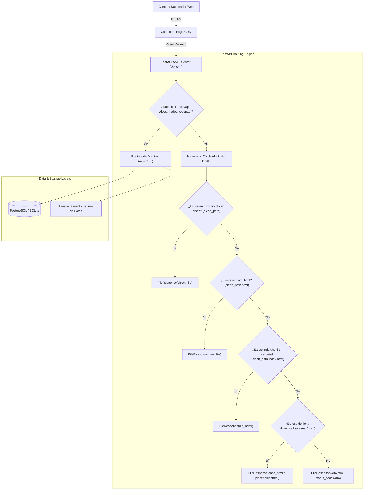

# ESTRUCTURA DE ALOJAMIENTO Y ENRUTAMIENTO FASTAPI
## Proyecto: Encuéntrame Nicaragua
**Fecha:** 20 de Noviembre de 2026  
**Auditor:** Ingeniero DevOps & Arquitecto de Software

---

## 1. ARQUITECTURA DE DESPLIEGUE INTEGRADA

La aplicación implementa una arquitectura desacoplada donde el servidor FastAPI y el frontend Next.js conviven armoniosamente bajo un único dominio o puerto, permitiendo servir tanto la interfaz pública para la ciudadanía como las APIs REST seguras para la gestión de reportes y pistas confidenciales.



---

## 2. UBICACIÓN DE ARCHIVOS ESTÁTICOS EN EL SERVIDOR

El servidor FastAPI inspecciona las siguientes ubicaciones candidatas para montar el frontend:
1. `./frontend/out`
2. `./out`
3. `../frontend/out`
4. `./static`

Estructura física del directorio `out`:

```text
frontend/out/
├── index.html                   # Página principal / Landing civic
├── 404.html                     # Manejador visual de rutas inexistentes
├── casos.html                   # Directorio de casos verificados
├── mapa.html                    # Mapa departamental Leaflet
├── reportar.html                # Formulario multipaso de reportes
├── pistas.html                  # Formulario confidencial de pistas
├── login.html                   # Autenticación y acceso seguro
├── admin.html                   # Panel administrativo y moderación
├── casos/                       # Directorio de casos
│   ├── index.html               # Espejo de casos.html
│   ├── case-01.html ... case-25.html
│   ├── EN-2026-0001.html ... EN-2026-0025.html
│   └── placeholder.html         # Plantilla cliente para casos dinámicos
├── mapa/
│   └── index.html               # Espejo de mapa.html
├── reportar/
│   └── index.html               # Espejo de reportar.html
├── pistas/
│   └── index.html               # Espejo de pistas.html
├── login/
│   └── index.html               # Espejo de login.html
├── admin/
│   └── index.html               # Espejo de admin.html
├── images/
│   ├── avatars/                 # Fotografías optimizadas WebP
│   └── leaflet/                 # Iconos y sombras del mapa
└── _next/
    └── static/                  # Bundles JS y CSS minificados
```

---

## 3. IMPLEMENTACIÓN EN CÓDIGO FASTAPI

En `main.py` y `backend/app/main.py`:

```python
# 1. Montaje de recursos estáticos inmutables
next_dir = os.path.join(OUT_DIR, "_next")
if os.path.isdir(next_dir):
    app.mount("/_next", StaticFiles(directory=next_dir), name="next_static")

images_dir = os.path.join(OUT_DIR, "images")
if os.path.isdir(images_dir):
    app.mount("/images", StaticFiles(directory=images_dir), name="images_static")

# 2. Manejador Catch-All con resolución jerárquica
@app.get("/{full_path:path}")
async def serve_static(full_path: str):
    # Proteger endpoints de API y documentación OpenAPI
    if full_path.startswith("api/") or full_path.startswith("docs") or full_path.startswith("redoc") or full_path.startswith("openapi.json"):
        return JSONResponse(status_code=404, content={"detail": "Not Found"})

    clean_path = full_path.strip("/")

    # 1. Archivo directo exacto
    direct_file = os.path.join(OUT_DIR, clean_path)
    if clean_path and os.path.isfile(direct_file):
        return FileResponse(direct_file)

    # 2. Archivo HTML directo (Clean URLs: /casos -> out/casos.html)
    html_file = os.path.join(OUT_DIR, f"{clean_path}.html")
    if clean_path and os.path.isfile(html_file):
        return FileResponse(html_file)

    # 3. Directorio con index.html (Trailing slash: /casos/ -> out/casos/index.html)
    dir_index = os.path.join(OUT_DIR, clean_path, "index.html")
    if clean_path and os.path.isfile(dir_index):
        return FileResponse(dir_index)

    # 4. Fichas de personas individuales
    if clean_path.startswith("casos/"):
        sub_id = clean_path.split("/", 1)[1]
        case_html = os.path.join(OUT_DIR, "casos", f"{sub_id}.html")
        if os.path.isfile(case_html):
            return FileResponse(case_html)
        placeholder_file = os.path.join(OUT_DIR, "casos", "placeholder.html")
        if os.path.isfile(placeholder_file):
            return FileResponse(placeholder_file)

    # 5. Respuesta 404 controlada
    not_found_file = os.path.join(OUT_DIR, "404.html")
    if os.path.isfile(not_found_file):
        return FileResponse(not_found_file, status_code=404)

    return JSONResponse(status_code=404, content={"error": "Página no encontrada"})
```

---

## 4. CICLO DE VIDA DE UNA PETICIÓN HTTP (REQUEST LIFECYCLE)

1. **Recepción en Edge:** La petición del cliente llega a Cloudflare con compresión GZIP/Brotli y certificado TLS válido.
2. **Despacho a FastAPI:** Cloudflare redirige al origen ASGI.
3. **Filtro de Seguridad y Cabeceras:** El middleware inyecta cabeceras de protección (`X-Content-Type-Options: nosniff`, `X-Frame-Options: DENY`, `Referrer-Policy: strict-origin-when-cross-origin`).
4. **Verificación de Enrutador:** FastAPI examina si la ruta pertenece a `/api/v1/*`.
   - Si pertenece a API, ejecuta el controlador con autenticación y validación Pydantic.
   - Si no pertenece a API, delega en el motor estático.
5. **Resolución Estática:** El motor estático localiza el archivo HTML, JS o CSS correspondiente y lo envía con su tipo MIME exacto (`text/html`, `application/javascript`, `text/css`, `image/webp`).
